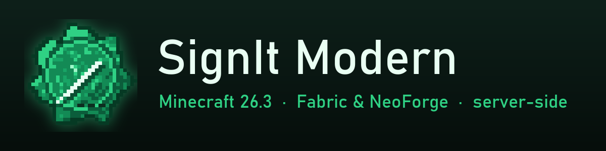

# SignIt Modern

    [](https://modrinth.com/mod/signit-modern) [](https://www.curseforge.com/minecraft/mc-mods/signit-modern) [](https://github.com/CptGummiball/SignItModern/releases)



**Sign any item with an emerald.** Hold the item in your main hand and an emerald in your off hand, right-click –
the item now carries your name, a UTC timestamp and a collectible rarity in its tooltip.

> **Based on / Inspiration:** Based on the gameplay concept of **Signit – A mod to sign anything!** by
> **gearsgodmaster**. Independently reimplemented for Minecraft 26.3 Fabric and NeoForge. Not affiliated with or
> endorsed by the original creator. Details: [CREDITS.md](CREDITS.md).

| | |
|---|---|
| Minecraft | 26.3 (exactly) |
| Loaders | Fabric (Loader ≥ 0.20.1, Fabric API ≥ 0.166.2+26.3) · NeoForge (≥ 26.3.0.109) |
| Java | 25 |
| Side | server-side; clients without the mod can join (see [Multiplayer](#multiplayer)) |
| Version | 1.0.0 |

## How it works

1. Hold the item you want to sign in your **main hand**.
2. Hold an **emerald** in your **off hand**.
3. **Right-click** (in the air, on a block or on an entity).

The server checks everything, takes one emerald and adds the signature:

```
Excalibur
Sharpness III
Forged in the Nether          <- existing lore stays untouched
Signed by: Alex
Signed on: 2026-11-17 14:03 UTC
Rarity: Rare
Signature ID: A8F3C2D1
```

German clients with the mod installed see `Signiert von: Alex`, `Signiert am: 17.11.2026 14:03 UTC`,
`Seltenheit: Selten`.

- **Stacks:** exactly one item is signed. From a stack, one item is split off, signed and put into a free
  inventory slot; without a free slot nothing happens (no loss, no duplication).
- **Already signed:** "This item has already been signed." – no emerald is taken.
- **Not an emerald in the off hand:** nothing happens, the item works normally.
- **Creative mode:** signing is free by default.
- **Everything else stays:** enchantments, custom names, damage, existing lore and data of other mods are kept.
- **No double signing:** the several packets of one click (and a held button) sign exactly once.
- **Placeable / usable items:** when SignIt takes the click, the normal use is cancelled on the server – a block is
  not placed, food is not eaten, a chest is not opened. Without an emerald in the off hand everything works as
  usual.

### Rarity

Rolled once when signing, stored with the signature, never re-rolled. Purely cosmetic – no attributes, no combat
or gameplay bonus.

| Tier | Colour | Default chance |
|---|---|---|
| Common | white | 60 % |
| Uncommon | green | 25 % |
| Rare | aqua | 10 % |
| Epic | light purple | 4 % |
| Legendary | gold | 1 % |

The original project describes a rarity rating but publishes no tiers or chances; these tiers are SignIt Modern's
own design. Weights are configurable.

## Commands

| Command | Who | What |
|---|---|---|
| `/signit` | everyone | short help |
| `/signit info` | everyone | full signature of the held item (signer UUID, ISO time, full id) and whether it matches the server's ledger |
| `/signit history` | everyone | your last 10 signatures from the ledger |
| `/signit history <player>` | operators (level 2) | last 10 signatures of an online player |
| `/signit reload` | operators | reload the configuration |
| `/signit config` | operators | show all settings with translated descriptions |

## Configuration

`config/signit_modern.properties` is created on the first start; it works without any change. Invalid values are
replaced by their defaults and reported in the log. `/signit reload` applies changes (ledger settings: restart).

| Key | Default | Meaning |
|---|---|---|
| `cost.emeralds` | `1` | emeralds per signature (0–64), from the off hand |
| `cost.free_in_creative` | `true` | creative players sign for free |
| `signing.permission_level` | `0` | permission level needed to sign (0 = everyone) |
| `signing.allow_resign` | `false` | allow signing a signed item again (the new signature replaces the old one) |
| `signing.require_sneak` | `false` | only sign while sneaking |
| `signing.cooldown_ticks` | `10` | window in which further clicks of the same player are ignored |
| `items.whitelist` | empty | only these items (ids, `mod:*`, `#tags`) |
| `items.blacklist` | empty | never these items |
| `rarity.common` … `rarity.legendary` | `600 250 100 40 10` | relative weights |
| `tooltip.show_time` / `show_rarity` / `show_signature_id` | `true` | lore lines of new signatures |
| `messages.success` | `true` | chat message after signing |
| `messages.announce` | `none` | announce `epic` or `legendary` signatures to everyone |
| `ledger.enabled` | `true` | server-side signature history |
| `ledger.backend` | `sqlite` | `sqlite` or `jsonl` |
| `signature.server_name` | empty | optional server label stored with signatures |
| `signature.store_world` | `true` | store the dimension id |

## Signature ledger

Every signature is also recorded on the server: `<world>/signit_modern/signatures.db` (SQLite, bundled driver,
no database server needed). Writes run on a background thread, never on the server tick. If SQLite cannot be
loaded on a platform, SignIt falls back to `signatures.jsonl` and says so in the log. `/signit info` compares an
item with its ledger entry.

## Multiplayer

SignIt Modern only needs to be installed on the server (dedicated or the host of a LAN world). It uses only vanilla
item data (`minecraft:custom_data`, `minecraft:lore`), registers no items, blocks or network channels, and sends
all texts as translatable components with an English fallback:

- clients **with** the mod see the texts in their language (English, German);
- clients **without** the mod see the English text.

See the wiki page *Supported Versions* for the combinations that were actually tested.

## Important: what a signature is – and is not

A signature is an in-game collector feature. It is **not** a cryptographic certificate of authenticity. Server
operators, players in creative mode (who can create any item) and anyone with access to the world files can create
or change item data. The ledger helps a server to spot items it never signed, nothing more.

## Installation

1. Install Fabric Loader + Fabric API, or NeoForge, for Minecraft 26.3.
2. Put `signit_modern-1.0.0+mc26.3-fabric.jar` or `signit_modern-1.0.0+mc26.3-neoforge.jar` into `mods/` of the
   server (and optionally the clients for translated texts).

## Documentation

- [Wiki](https://github.com/CptGummiball/SignItModern/wiki)
- [CREDITS](CREDITS.md) – original project, author, independent reimplementation
- [CHANGELOG](CHANGELOG.md)

## Links

*   [Wiki](https://github.com/CptGummiball/SignItModern/wiki)
*   [Supported versions](https://github.com/CptGummiball/SignItModern/wiki/Supported-Versions)
*   [Report a bug](https://github.com/CptGummiball/SignItModern/issues/new/choose)
*   [Request a Minecraft version](https://github.com/CptGummiball/SignItModern/issues/new?template=version_request.yml)
*   [API for mod developers](https://github.com/CptGummiball/SignItModern/blob/main/api/README.md)

## License

SignIt Modern License (proprietary, modpacks allowed in unmodified form) – see [LICENSE](LICENSE). The bundled
SQLite JDBC driver is Apache 2.0.
